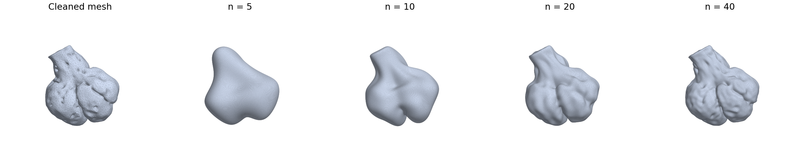

# Spherical-harmonic shape reconstruction: a worked example

Reconstruct the **control gland 241104-SMG5, frame 160 (13 h 20 min)**,
the later control time point in Fig. S4. This example recomputes the harmonic
coefficients from a cleaned mesh and its validated spherical parameterization,
then exports reconstructions at maximum degrees **5, 10, 20 and 40**.



All panels share an orthographic top view and physical magnification. This is
a demonstration preview; the manuscript figure uses its own layout and cameras.
The meshes preserve physical coordinates in micrometres.

## Run the example

Use Python **3.11 or 3.12** with the pinned dependencies below. From the
repository root, create/activate a virtual environment as in the main README,
then run:

```bash
python -m pip install -r spherical-harmonics/requirements.txt
python spherical-harmonics/reconstruct.py --verify
```

VTK is used for geometric queries and mesh construction; the preview is rendered
with Matplotlib without opening a window. No GPU, display server, TeX or Arial
is required. The default reconstruction samples 128 x 256 spherical directions
and evaluates a 16,386-vertex, 32,768-triangle display mesh. Allow approximately
a minute, depending on the computer.

`--verify` checks source hashes, recomputed coefficients and errors against the
stored manuscript reference, and an analytic offset-ellipsoid example. Expected
final output includes `"verification": "passed"`.

The generated files are written to `spherical-harmonics/results/`:

| File | Contents |
| --- | --- |
| `coefficients.npz` | Complex coefficients and the translation restored after evaluation |
| `reconstruction_n05.npz`, `n10`, `n20`, `n40` | Double-precision `vertices` and zero-based triangle `faces` |
| `reconstruction_n05.ply`, `n10`, `n20`, `n40` | The same surfaces as standard xyz PLY meshes for MeshLab, ParaView or other mesh viewers |
| `degree_comparison.png` | Cleaned input and the four reconstructed surfaces |
| `reconstruction_report.json` | Map checks, quadrature, geometric errors and reference verification |

Generated PLY/NPZ outputs are ignored by Git; the preview and numerical report
are included for inspection without running the code. Re-running replaces files
with the same output names. Use `--output-dir /path/to/results` for another folder
or `--no-preview` to skip rendering.

The separate scientific tests can be run with:

```bash
python -m unittest discover -s spherical-harmonics -p 'test_*.py' -v
```

## What is reconstructed?

A spherical parameterization associates each vertex of the gland mesh with a
point on the unit sphere. Let $g:M\rightarrow\mathbb{S}^2$ denote that map. We
expand the three Cartesian components of its inverse, rather than a scalar
radius:

$$
\mathbf{x}^{(n)}(\Omega)=\sum_{\ell=0}^{n}\sum_{m=-\ell}^{\ell}
\mathbf{a}_{\ell m}Y_\ell^m(\Omega),\qquad
\mathbf{a}_{\ell m}=\int_{\mathbb{S}^2}\mathbf{x}(\Omega)
Y_\ell^{m*}(\Omega)\,\mathrm{d}\Omega.
$$

The script follows these steps:

1. Validate the connected, closed genus-zero mesh, unit sphere radii, consistent
   spherical triangle orientations and spherical area $4\pi$.
2. Subtract the physical bounding-box centre. For each quadrature direction,
   intersect a ray with the **spherical triangulation**, then use that triangle's
   barycentric weights to interpolate the corresponding physical gland coordinates.
3. Integrate with **128 Gauss-Legendre nodes in $\cos\theta$** and **256 equally
   spaced azimuthal nodes**, using an FFT in azimuth.
4. Retain coefficients through degree 40, evaluate the requested cutoffs on one
   common triangular sphere and restore the translation.

Ray intersection is performed on the spherical map. The gland itself can have
clefts and overhangs; it need not be star-shaped. The same coordinate expansion
supplies every degree cutoff.

The complex orthonormal basis uses SciPy's
[`sph_harm_y(ell, m, theta, phi)` convention](https://docs.scipy.org/doc/scipy/reference/generated/scipy.special.sph_harm_y.html):
$\theta$ is colatitude, $\phi$ is azimuth, and the associated Legendre polynomials
already include the Condon-Shortley phase. For $m\geq0$,
$Y_\ell^m=N_{\ell m}P_\ell^m(\cos\theta)e^{im\phi}$; negative orders obey
$Y_\ell^{-m}=(-1)^mY_\ell^{m*}$.

Only nonnegative orders are stored, as
`coefficients[ell, m, component]`, with components **x,y,z**. Entries with
`m > ell` are zero. The coordinate functions are real, so the negative-order
terms are recovered through $\mathbf{a}_{\ell,-m}=(-1)^m\mathbf{a}_{\ell m}^*$.
Evaluation therefore uses the $m=0$ term plus
$2\operatorname{Re}(\mathbf{a}_{\ell m}Y_\ell^m)$ for each $m>0$. Coefficients
describe the **centred** coordinates; use `center_xyz_um` when evaluating them.
A cutoff $n$ still represents all $(n+1)^2$ harmonics for each coordinate.

## Expected reconstruction errors

| Maximum degree | RMS error (micrometres) | Maximum error (micrometres) |
| --- | ---: | ---: |
| 5 | 8.540700 | 34.122507 |
| 10 | 4.953717 | 21.417423 |
| 20 | 2.524069 | 10.052722 |
| 40 | 1.068267 | 8.098228 |

These compare reconstructed coordinates with the input gland vertices at their
corresponding spherical locations. RMS is unweighted across vertices. These are
vertex-correspondence errors, rather than closest-surface or Hausdorff distances.
The example's full cleaned mesh has **5,002 vertices and 10,000 faces**; it was
used without decimation. Increasing degree recovers finer surface detail.

## Input data and spherical parameterization

The compact `example/` folder contains:

- `241104-SMG5_f160_cleaned.ply`: the cleaned physical mesh in xyz micrometres.
- `241104-SMG5_f160_map.npz`: physical `vertices`, zero-based `faces`, and
  vertex-matched `sphere_vertices` on the unit sphere.
- `reference_coefficients.npz`: saved coefficients from the manuscript calculation,
  used only for verification; the demo recomputes its own coefficients.
- `provenance.json`: original mesh hash, map-generation settings and reference errors.

Original paper meshes store physical columns in **z,y,x** order. This example
permutes physical coordinates and reference-coefficient components to conventional
**x,y,z** order. Vertex positions and their spherical correspondences are otherwise
unchanged. Exported PLY/reconstruction faces are oriented outward; a global winding
reversal changes normals without changing the surface geometry.

The supplied spherical map was computed with the published
[Spherical Density-Equalizing Map implementation](https://github.com/garyptchoi/spherical-density-equalizing-map)
by Lyu, Lui and Choi (*SIAM Journal on Imaging Sciences* 17(4), 2110-2141, 2024),
initialized with FLASH and Mobius area correction. The manuscript workflow ran
the MATLAB source under GNU Octave 10.3, used bounded SQP for the Mobius objective,
and corrected residual local spherical foldovers. In this example, one folded
triangle was corrected; the maximum displacement on the sphere was 0.274 degrees.
Physical gland coordinates were unchanged. Exact settings are in `provenance.json`.

This Python example **starts from that validated spherical map**. It reproduces
the SH fitting and reconstruction stage; it does not rerun FLASH, SDEM or the
local map correction. The upstream mapping software is a separate dependency
when constructing a parameterization for another mesh.

## Use another mapped mesh

First compute and validate a spherical parameterization for a connected, closed
genus-zero surface. Preserve the vertex correspondence and triangle connectivity.
Save a NumPy archive with this schema:

```python
import numpy as np

np.savez_compressed(
    "my_map.npz",
    vertices=physical_xyz_um,    # (N, 3), physical coordinates
    faces=triangles,            # (F, 3), zero-based integers
    sphere_vertices=unit_map,   # (N, 3), matching unit-sphere coordinates
)
```

Then run:

```bash
python spherical-harmonics/reconstruct.py --input my_map.npz --output-dir my_SH --degrees 5 10 20 40
```

For MATLAB triangle arrays, subtract one from the indices before saving. Convert
physical units to micrometres if you want the output error units to match the
report labels. `--verify` is specific to the bundled example and should be omitted
for other data. For higher degrees, increase `--ntheta` and `--nphi` and check
quadrature convergence; the script requires `ntheta > n` and `nphi > 2*n`.

Code is covered by the repository MIT license; example geometry, spherical maps,
coefficients and results are covered by CC BY 4.0. Please credit Tauber et al.
and the cited spherical-parameterization method when reusing the example.
